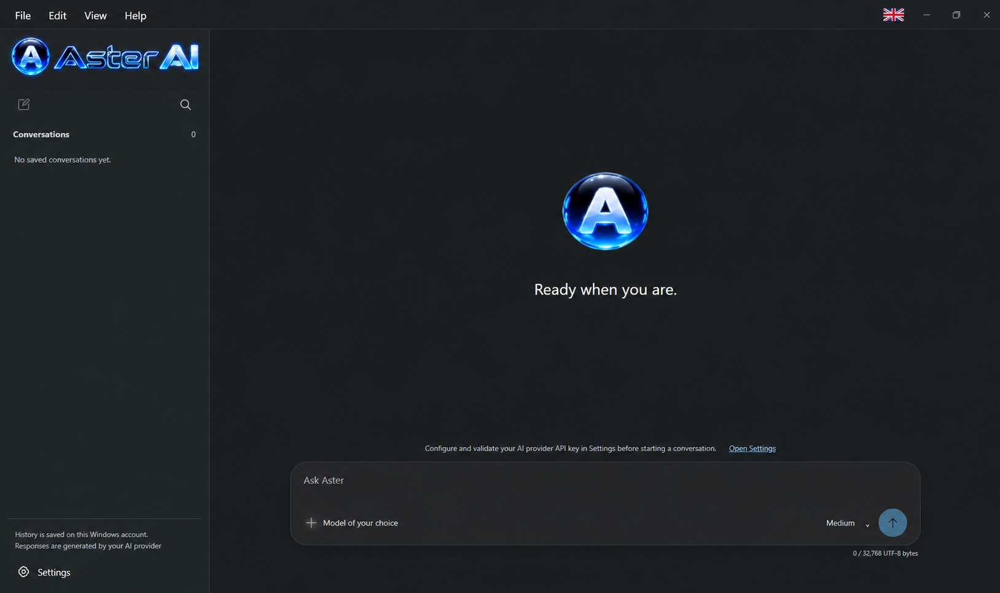

# COMZULCA — Open-Source License and Disclaimer

Computación Zuliana C.A. (COMZULCA) is a Venezuelan company seeking to grow and expand with the support of the global developer community. By sharing our software openly, we welcome collaboration, contributions, and opportunities to build useful technology together.

Aster-desktop and all other COMZULCA software products are licensed under the Apache License, Version 2.0. Anyone may use, reproduce, modify, distribute, and create derivative works, including for commercial purposes, without paying COMZULCA license fees or royalties. Commercial use requires no separate permission from COMZULCA, provided the applicable license terms are met.

These permissions are subject to Apache 2.0 and applicable law. Redistribution requires compliance with its conditions, including supplying the license, identifying modified files, and preserving required attribution and NOTICE information. Third-party components retain their respective licenses. Trademark rights are limited to those permitted by Apache 2.0.

Each user, developer, distributor, or other third party is solely responsible for their own decisions, actions, modifications, deployments, and use of COMZULCA products and derivative works. Any misuse, infringement, unlawful activity, unethical conduct, or other improper practice is the responsibility of the individuals or entities involved. COMZULCA and its business partners do not authorize or endorse such conduct and assume no responsibility for decisions or actions taken independently by persons or entities outside the company, to the fullest extent permitted by applicable law.

The products are provided **“AS IS,” without express or implied warranties**, including merchantability, fitness for a particular purpose, and non-infringement, except as required by law or expressly agreed in writing.

To the fullest extent permitted by applicable law, and except for obligations expressly accepted in writing, **neither COMZULCA nor its business partners shall be liable for third-party misuse of COMZULCA products or derivative works, or for resulting losses, damages, claims, or other consequences**. Nothing in this disclaimer excludes or limits liability that cannot legally be excluded or limited.

This disclaimer supplements the Apache License 2.0 without changing its terms or adding restrictions. In the event of conflict, the license governs, subject to applicable law.

Full license: [Apache License, Version 2.0](https://www.apache.org/licenses/LICENSE-2.0).



*Interface preview supplied by COMZULCA. Available capabilities and engineering qualification are documented in the [v0.2.4 index](docs/V0.2.4-DOCUMENTATION-INDEX.md).*

# Aster Desktop

A Windows 11 desktop assistant by Computación Zuliana C.A. (COMZULCA), built with Tauri, Rust, React and TypeScript. The trusted native host owns credentials, document custody, exact disclosure review and spending admission.

**Current version: 0.2.4, unsigned engineering.** The delivered software snapshot is main [`57339a6`](https://github.com/comzulca/Aster-desktop/commit/57339a687125a0b1fd8d6cda787649b5a111fa65), verified on 5 November 2026. A later documentation commit does not retag or requalify those installer bytes.

[Current engineering status](docs/ENGINEERING-STATUS.md) · [Setup and use](docs/SETUP-AND-USE.md) · [Version index](docs/V0.2.4-DOCUMENTATION-INDEX.md) · [Engineering notes](docs/RELEASE-NOTES-v0.2.4.md) · [Licence](LICENSE)

## Current engineering build

[Main CI run 42081672227](https://github.com/comzulca/Aster-desktop/actions/runs/42081672227), attempt 1, passed all five mandatory jobs, 178 frontend tests, the 412-PASS Rust suite and the actual fifteen codec/six resource probes. Two native credential cases excluded from the default suite passed separately against disposable hosted targets. This is automated engineering evidence, with owner-installed/live/production acceptance separate.

The installer is `Aster Desktop_0.2.4_x64-setup.exe` (24,204,364 bytes; Authenticode `NotSigned`). Its byte-identical delivery alias is `Aster_0.2.4_x64_Engineering_57339a6-setup.exe`.

```text
SHA-256 70e566cc9a279fded4730ec05abe6496105daf81fccc701c87642a0737d39366
```

See the [exact engineering receipt](docs/qa/FINAL-ENGINEERING-V024-20261105.md) for the source, artifact, ZIP digest, native probes, independent payload verification and qualification limits. GitHub Actions artifacts have limited retention; this is not a signed or published production release.

## Latest behaviour

- The only model is **Muse Spark 1.3 Contributor** through the fixed direct Meta API. Current-key authentication is separate from account eligibility, billing and quota.
- `+` adds documents to the current unsent selection. Cancelling or atomically rejecting an addition retains the previous selection and draft. The combined batch keeps its four-file and earliest five-minute limits; adding files does not renew custody.
- The policy review performed on 5 November recognises the 9 October terms and 12 October geographic policy. Aster's local review deadline is **6 December 2026 at 00:00 UTC**. This is not expiry of a Meta key, account or subscription. Existing terms/financial records remain; current native terms and budget review are required.
- Eligible conversations and processed derivatives use protected local storage. Temporary originals and disclosure grants are not restored after restart.
- Personalization stays local. Skills/Plugins are bounded inert content; the built-in GitHub connector has separately controlled authentication/read routes. Runtime GitHub writes and automatic full-window compaction remain unavailable.

[Attachment contract](docs/providers/attachments.md) · [Provider contract](docs/providers/meta-muse-spark-1.3-contributor.md) · [Transport](docs/providers/transport.md) · [Maintenance specification](docs/specs/SPEC-0007.md)

## Contributor privacy, access and credentials

Contributor content may be used for training. Personal, sensitive and confidential content, including code that must remain confidential, is prohibited. An eligibility declaration or encryption of local history does not override that rule. Use only synthetic or eligible public content and review each complete outbound request in the native Windows dialogue.

Enter keys only through Aster's native Windows credential dialogue. Direct Model API access and coding-harness subscription credentials have different usage rights; a subscription credential restricted to its coding harness must not be reused in Aster. Authentication does not establish invoice limits, credits or territorial eligibility. See the [dated primary-source review](docs/providers/META-POLICY-REVIEW-20261105.md) and [setup guide](docs/SETUP-AND-USE.md).

## Protected history and money

The host re-admits eligible continuation and separately reviews every complete disclosure. Restored history never restores active requests, approvals, temporary originals or grants. Current encrypted payload limits are 64 MiB for transcript history and a separate 128 MiB for processed media; filesystem/ciphertext overhead is distinct. The proposed 4-GiB transcript migration is not active.

The local £89 calendar-month admission ceiling uses `Europe/London`, warns at £80.10 and requires explicit owner-confirmed FX/margin/tax/payment assumptions. Configuration lasts at most 31 days and cannot outlive the reviewed policy. Unknown charges retain reservations and block new dispatch until reviewed reconciliation; deletion, restart or changing an alias does not reset spending. This local control does not cap other clients or guarantee Meta's invoice.

## Resource and authority limits

Policy and IPC protocol are **4**. Runtime text context remains at most 20 completed continuation turns / 512 KiB, with 32-KiB user input and 8,192 output tokens. The 512-KiB text bound and separate 24-MiB complete media-request bound are distinct. The model's larger documented window does not enable the unfinished full-window migration.

Main-chat model tools, arbitrary shell/browser/MCP, voice and image generation are unavailable. Processed attachments and explicit local UI actions do not confer those privileges. See the [current status and limits](docs/ENGINEERING-STATUS.md) for implemented, test-only and unqualified capabilities.

## Source checks and Windows build

Read [AGENTS.md](AGENTS.md), then [BUILDING.md](docs/BUILDING.md). The pinned cohort is Node 24 (`>=24.15.0 <25`), pnpm 11.19.0 and Rust 1.97.0, with the Windows MSVC/WebView2 prerequisites. Use frozen lockfiles and the unchanged five-job workflow; generating an executable alone is not package qualification.

## Licence, contribution and history

COMZULCA-owned material uses [Apache 2.0](LICENSE); retain [NOTICE](NOTICE), [third-party terms](docs/LICENSING.md) and packaged notices. Package-publication guards remain enabled. Read the [licensing transition](docs/qa/OPEN-SOURCE-TRANSITION-20261102.md) for its exact scope.

The complete pre-reconciliation README is preserved byte-for-byte in [README-ARCHIVE-57339a6.md](README-ARCHIVE-57339a6.md). Its dated current/pending/FAIL/PASS statements describe their original sources. The [documentation reconciliation](docs/qa/DOCUMENTATION-RECONCILIATION-20261105.md) records corrections and archive identities; historical evidence is not silently promoted into current acceptance.
