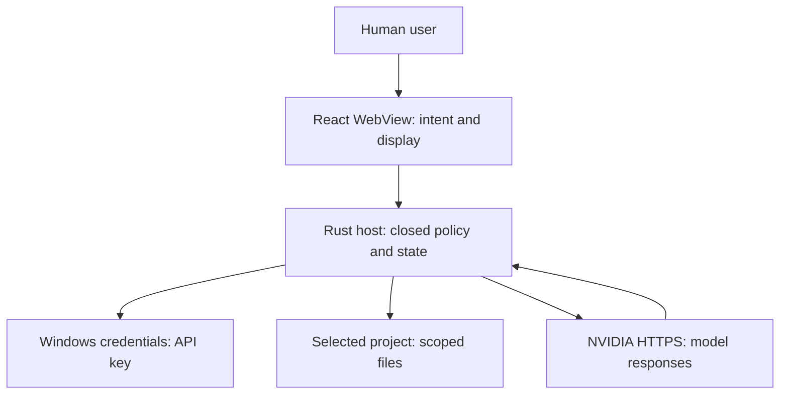

# THREAT-MODEL-0001 — Aster-desktop v0.1.0

Status: design threat assessment, 2026-09-24 UTC. Scope: Windows 11 app, local project, native credential custody, two NVIDIA hosted models, private source repository. No mitigation is marked implemented until a test at the stated boundary passes. Source of normative IDs: `docs/specs/SPEC-0001.md`. Decisions: `docs/adr/ADR-0001.md`, `ADR-0002.md`, `ADR-0003.md`.

## Assets, actors and boundaries

| Classification | Examples | Expected handling |
| --- | --- | --- |
| Secret | NVIDIA API key | Native Windows credential store and trusted Rust process memory only. Never renderer, repo, export, trace or model input. |
| Restricted | Local project files, proposed diffs, chat messages, prompt excerpts | Host-scoped reads; UI displays only authorized excerpts. Disclose to NVIDIA through explicit per-request send. No disk chat history. |
| Untrusted | NVIDIA SSE/JSON, model text, selected project files/AGENTS.md, filenames | Parse with size/schema limits; render as inert data. Instructions inside them cannot change host permissions. |
| Internal operational | Root identity, grants, nonces, file hashes, journal, status logs, source commit/build artifacts | Host-only decision state, minimal redacted logs, versioned policy, revision-bound evidence. |

The human user controls root selection and individual approvals, but a compromised user account or malicious same-user process is outside the Credential Manager confidentiality guarantee. The renderer, all model output, local project content and remote provider are lower-trust inputs. The host is the only authority broker; Windows OS and filesystem provide primitives whose real behavior must be tested on the target.

The arrows cross different trust boundaries: user intent to renderer, untrusted renderer to privileged host, host to Windows Credential Manager, host to mutable filesystem and host to external NVIDIA. GitHub/CI introduces an independent source/release boundary; repository privacy is verified as an operational property, not assumed from its name.

## Abuse cases and proposed controls

| TM | Threat and entry point | Requirement / acceptance / negative test | Mitigation owner and intended behavior | Residual risk / gate |
| --- | --- | --- | --- | --- |
| TM-001 | Malicious WebView, renderer XSS or forged window invokes credential getter or sees key in IPC/logs. | SEC-001, SEC-002 / AC-013, AC-020 / T-015, T-022 | Rust credential service; native key input; restrict Tauri command permissions to trusted window, never return bytes. Synthetic Windows credential and forged caller tests. | Same-user malware still possible (TM-012). Windows test NOT RUN. |
| TM-002 | Prompt injection in model text or project `AGENTS.md` asks the host to execute shell/web/MCP or approve a file write; caller forges typed IPC. | SEC-002, FR-012 / AC-014, AC-020 / T-016, T-022 | Rust IPC policy; closed schemas, caller/window check, unknown field and oversized rejection, plain-text rendering. Renderer event cannot grant itself privilege. | Host implementation NOT RUN. |
| TM-003 | Provider/model confusion, injected URL, redirect or proxy sends key to another origin; malformed SSE triggers retries or cross-request state. | SEC-003, FR-001, FR-002 / AC-003, AC-004, AC-021 / T-003, T-004, T-005, T-023 | NVIDIA adapter; exact origin/model allowlist, HTTPS/TLS, reject redirect/proxy, no implicit retry/fallback, bounded parser and per-pair fixtures. | Contract/cost may change; official source and live canary separately NOT RUN. |
| TM-004 | Renderer or model passes `..`, absolute/UNC/device path, malformed separator or stale root to read or write outside selected project. | SEC-004, FR-005, FR-006 / AC-007, AC-008, AC-022 / T-008, T-009, T-010, T-024 | Windows file service; native root selection, identity-bound grants, component walk, typed relative paths, no absolute path accepted from WebView. | TOCTOU and filesystem behavior require Windows tests. |
| TM-005 | Symlink, junction, reparse path, hardlink, ADS, protected `.git`/secret file or binary aliases an unintended resource. | SEC-004, SEC-006 / AC-008, AC-022 / T-010, T-024 | Windows file service; deny any reparse component, hardlink count >1, ADS/UNC/device paths, deny sensitive names, limit UTF-8 and size; revalidate identity at use. | Hardlink aliases/backup privileges outside threat model; target OS check NOT RUN. |
| TM-006 | Model calls an unlisted tool, auto-approves a proposal, swaps diff after review or replays/duplicates a confirmation. | SEC-005, FR-007, FR-008 / AC-009, AC-010, AC-023 / T-011, T-012, T-025 | Grant state machine; typed proposal, exact UI review, separate human action, nonce, request/conversation/root/path/old+new SHA-256, expiry and one use, host revalidation. | Human can approve a malicious but faithfully displayed change; no automated semantic safety claim. |
| TM-007 | Concurrent writer changes a file after comparison, `ReplaceFileW` targets wrong generation, crash leaves partial/ambiguous state or journal is lost. | SEC-006, FR-008, FR-009 / AC-010, AC-011, AC-024 / T-012, T-013, T-026 | Windows file service; identity/hash recheck, durable protected backup/journal, `CREATE_NEW` for new files, conservative recovery and native Windows race testing. `ReplaceFileW` by path is not expected-hash CAS. | Existing-file apply **disabled/proposal-only** until guarded same-handle write/recovery proof; in-place interruption can expose partial content. New-file creation likewise gated. No PASS claimed. |
| TM-008 | Duplicate/out-of-order SSE or cancellation causes multiple terminal results, cross-conversation content or post-cancel tool execution. | NFR-001, FR-003 / AC-005, AC-017 / T-006, T-019 | Host state machine; unique request IDs, fixed transitions, exactly one terminal event, cancellation token, per-request parser isolation; compare repeated fixtures. | Live provider timings remain nondeterministic. |
| TM-009 | Oversized file, infinite stream, slow network, huge diff, excessive events or repeated calls consume resources/cost. | NFR-002 / AC-018 / T-020 | Host budgets; one outstanding request/conversation, 1 MiB text read, 256 KiB proposal, 8 MiB response, 256 KiB frame, 262,144 events, 10s connect/30s headers/60s idle/900s total, zero automatic retries/tool loop. | Provider billing can still accrue within one authorized request; no hard provider spending cap claimed. |
| TM-010 | Project contents leak through implicit prompt assembly, debug logs, desktop persistence, export, crash dumps or source control. | SEC-007, SEC-008 / AC-012, AC-025 / T-014, T-027 | Host/UI and release engineer; explicit per-request project disclosure, bounded ephemeral context, redacted logs, deny secret files and no chat database. | OS crash dumps and same-user memory inspection require separate OS hardening; no zero leakage promise. |
| TM-011 | Public repo, inherited org roles, stale green CI, unsigned older artifact or secret in commit creates a false release/privacy claim. | PR-002, SEC-009 / AC-002, AC-019 / T-002, T-021 | Repo owner and release engineer; inspect organization roles/visibility, secret and license scans, pinned revision, artifact hash/signature evidence and explicit promotion decision. | Repository privacy and scoped connector access were verified at publication; other organization/enterprise owners, collaborators and branch rules still require review at promotion. |
| TM-012 | Another process running as the same Windows user calls `CredReadW` for a generic credential. | SEC-001 / AC-013 / T-015 | OS/host boundary; minimize key lifetime in process and never expose via renderer; Windows Defender/ESET account compromise controls remain operational. | Inherent residual risk of Windows Generic Credential user scope; user-owner risk acknowledgment pending, cannot claim exclusive app access. |

## Explicit release blockers

1. No Windows Credential Manager test means the live credential path is **NOT RUN**; use fake-store tests only and do not declare live Windows connectivity.
2. No per-provider fake SSE + live canary means the corresponding NVIDIA model is **NOT RUN** or disabled. A fixture PASS alone does not claim live compatibility.
3. No native Windows race/crash/recovery tests and safe existing-file publication primitive means existing-file **apply** is disabled, even if proposal rendering passes. `CREATE_NEW` is independently gated.
4. The private repository, one organization member visible at inspection, and repository-scoped connector authorization were verified at publication. Other inherited organization/enterprise privileges, collaborators and branch rules have not been exhaustively verified for a sole-owner release claim.
5. No Windows package test, artifact hash and signing evidence means no production installer claim. CI can establish source quality for the exact revision only.

## Review instructions

For every new provider, grant, tool, storage format or IPC command, add a threat and an adversarial test before enabling the capability. An observed FAIL remains visible; a follow-up PASS must identify the new revision and run. Human approval is authorization for the requested operation, not proof the model's proposed code is safe or correct.
