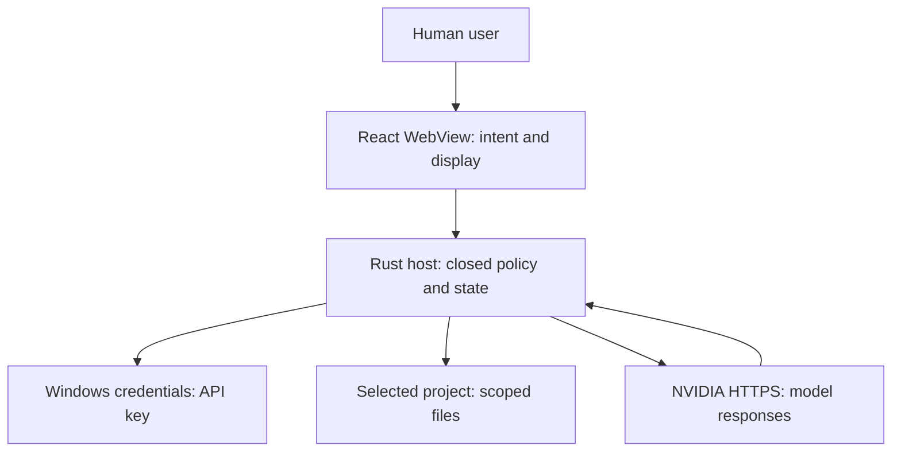

# THREAT-MODEL-0001 — Aster-desktop v0.1.0

Status: versioned threat assessment, created 2026-09-24 UTC and reconciled for the protocol-2 engineering candidate on 2026-10-01 UTC. Scope: Windows 11 app, local project, native credential custody, two NVIDIA hosted models, private source repository. Code presence is not acceptance; each mitigation is credited only at its tested boundary and source revision. Source of normative IDs: `docs/specs/SPEC-0001.md`. Decisions: `docs/adr/ADR-0001.md` through `ADR-0006.md`, `ADR-0008.md`, and `ADR-0009.md`.

## Assets, actors and boundaries

| Classification | Examples | Expected handling |
| --- | --- | --- |
| Secret | NVIDIA API key | Native Windows credential store and trusted Rust process memory only. Never renderer, repo, export, trace or model input. |
| Restricted | Local project files, proposed diffs, chat messages, project-bearing prompts | Host-scoped reads; renderer receives file metadata only, while the owner-HWND native surface displays the exact disclosure/proposal. Disclose to NVIDIA through explicit per-request send. No disk chat history. |
| Untrusted | NVIDIA SSE/JSON, model text, selected project files/AGENTS.md, filenames | Parse with size/schema limits; render as inert data. Instructions inside them cannot change host permissions. |
| Internal operational | Root identity, grants, nonces, file hashes, journal, status logs, source commit/build artifacts | Host-only decision state, minimal redacted logs, versioned policy, revision-bound evidence. |

The human user controls root selection and individual approvals, but a compromised user account or malicious same-user process is outside the Credential Manager confidentiality guarantee. The renderer, all model output, local project content and remote provider are lower-trust inputs. The host is the only authority broker; Windows OS and filesystem provide primitives whose real behavior must be tested on the target.

The arrows cross different trust boundaries: user intent to renderer, untrusted renderer to privileged host, host to Windows Credential Manager, host to mutable filesystem and host to external NVIDIA. GitHub/CI introduces an independent source/release boundary; repository privacy is verified as an operational property, not assumed from its name.

## Abuse cases and proposed controls

| TM | Threat and entry point | Requirement / acceptance / negative test | Mitigation owner and intended behavior | Residual risk / gate |
| --- | --- | --- | --- | --- |
| TM-001 | Malicious WebView, renderer XSS or forged window invokes credential getter or sees key in IPC/logs. | SEC-001, SEC-002 / AC-013, AC-020 / T-015, T-022 | Rust credential service; native key input; restrict Tauri command permissions to trusted window, never return bytes. Synthetic Windows credential and forged caller tests. | Same-user malware still possible (TM-012). Current local automatic fixtures pass; immutable-source binding and installed-app secret-boundary evidence are pending. |
| TM-002 | Prompt injection in model text or project `AGENTS.md` asks the host to execute shell/web/MCP or approve a file write; caller forges typed IPC or capability status. | SEC-002, SEC-013, FR-012, FR-015 / AC-014, AC-020, AC-028 / T-016, T-022, T-038 | Rust IPC policy; closed schemas, caller/window check, protocol-2 capability validation, unknown field and oversized rejection, plain-text rendering. Renderer event cannot grant itself privilege. | Local changed-working-tree automatic evidence passes; immutable-source/CI binding and manual installed-app boundary inspection remain pending. |
| TM-003 | Provider/model confusion, injected URL, redirect or proxy sends key to another origin; malformed SSE triggers retries or cross-request state. | SEC-003, FR-001, FR-002 / AC-003, AC-004, AC-021 / T-003, T-004, T-005, T-023 | NVIDIA adapter; exact origin/model allowlist, HTTPS/TLS, reject redirect/proxy, no implicit retry/fallback, bounded parser and per-pair fixtures. | Current working-tree exact-pair loopback fixtures pass; immutable-source/CI binding and both live canaries remain independent. |
| TM-004 | Renderer or model passes `..`, absolute/UNC/device path, malformed separator or stale root to read or write outside selected project. | SEC-004, SEC-012, FR-005, FR-006, FR-016 / AC-007, AC-008, AC-022, AC-029 / T-008, T-009, T-010, T-024, T-039 | Windows file service; native root/file selection, identity-bound grants, component walk, typed relative paths, metadata-only IPC and final host revalidation. | Local changed-working-tree integration passes; immutable-source/CI binding and installed Windows 11 review remain pending. |
| TM-005 | Symlink, junction, reparse path, hardlink, ADS, protected `.git`/secret file or binary aliases an unintended resource. | SEC-004, SEC-006 / AC-008, AC-022 / T-010, T-024 | Windows file service; deny any reparse component, hardlink count >1, ADS/UNC/device paths, deny sensitive names, limit UTF-8 and size; revalidate identity at use. | Local native fixtures pass; immutable-source binding and installed target review are pending. Hardlink aliases/backup privileges outside the threat model remain residual. |
| TM-006 | Model calls an unlisted tool, auto-approves a proposal, swaps diff after review or replays/duplicates a confirmation. | SEC-005, SEC-013, FR-007, FR-008, FR-017 / AC-009, AC-010, AC-023, AC-030 / T-011, T-012, T-025, T-040 | Grant state machine; typed proposal, exact owner-HWND native review, separate human action, nonce, request/conversation/root/path/old+new SHA-256, expiry and one use, host revalidation. Existing replacement never publishes. | Human can approve a malicious but faithfully displayed new file; no automated semantic safety claim. Local automatic integration passes; immutable-source and manual evidence remain pending. |
| TM-007 | Concurrent writer changes a file after comparison, `ReplaceFileW` targets wrong generation, crash leaves partial/ambiguous state or journal is lost. | SEC-006, FR-008, FR-009, FR-017 / AC-010, AC-011, AC-024, AC-030 / T-012, T-013, T-026, T-040 | Windows file service; identity/hash recheck, private durable metadata journal, `CREATE_NEW` for new files, same-handle verification and conservative recovery. `ReplaceFileW` by path is not expected-hash CAS. | Existing-file apply is **disabled/proposal-only**. Local new-file independent-process termination/restart fixtures pass on the changed working tree; immutable-source/CI/package binding and physical power-loss evidence remain pending. |
| TM-008 | Duplicate/out-of-order SSE or cancellation causes multiple terminal results, cross-conversation content or post-cancel tool execution. | NFR-001, FR-003 / AC-005, AC-017 / T-006, T-019 | Host state machine; unique request IDs, fixed transitions, exactly one terminal event, cancellation token, per-request parser isolation; compare repeated fixtures. | Live provider timings remain nondeterministic. |
| TM-009 | Oversized file, infinite stream, slow network, huge diff, excessive events or repeated calls consume resources/cost. | NFR-002, NFR-004 / AC-018, AC-031 / T-020, T-041 | Host budgets; one application-wide active provider request, 64 KiB input, 512 KiB context/answer, 1 MiB text read, 256 KiB changed content, 8 MiB wire response, 256 KiB frame, 262,144 events, 10s connect/30s headers/60s idle/900s total, zero automatic retries/tool loop. | Provider billing can still accrue within one authorized request; no hard provider spending cap or provider-latency guarantee claimed. |
| TM-010 | Project contents leak through renderer IPC, implicit prompt assembly, continuation history, stale snapshot/proposal memory, debug logs, desktop persistence, export, crash dumps or source control. | SEC-007, SEC-008, SEC-012 / AC-012, AC-025, AC-029 / T-014, T-027, T-039 | Host/UI and release engineer; metadata-only IPC, exact per-request native disclosure, 32-KiB ephemeral project turn, failed/cancelled snapshot revocation, five-minute rights plus 60-second expiry heartbeat, redacted logs, deny secret files and no chat database. | Completed egress intentionally retains only the bounded proposal right until expiry. OS crash dumps and same-user memory inspection require separate OS hardening; no zero leakage promise. Installed-app inspection is pending. |
| TM-011 | Public repo, inherited org roles, stale green CI, unsigned older artifact, incomplete notice provenance or secret in commit creates a false release/privacy claim. | PR-002, SEC-009 / AC-002, AC-019 / T-002, T-021 | Repo owner and release engineer; inspect roles/visibility, secret and license scans, pinned revision, schema-2 target-required notice closure, extracted NSIS resource hashes, artifact hash/signature evidence and explicit promotion decision. | Repository privacy and scoped connector access were verified at publication; roles/rules require promotion review. Structural notice/payload evidence is neither an exact binary SBOM nor legal approval. |
| TM-012 | Another process running as the same Windows user calls `CredReadW` for a generic credential. | SEC-001 / AC-013 / T-015 | OS/host boundary; minimize key lifetime in process and never expose via renderer; Windows Defender/ESET account compromise controls remain operational. | Inherent residual risk of Windows Generic Credential user scope; user-owner risk acknowledgment pending, cannot claim exclusive app access. |
| TM-013 | Diagnostic arguments, target confusion, malformed/pre-existing credentials or unconditional cleanup cause a synthetic GUI test to access/change/delete production or unrelated credentials. | FR-013, SEC-010 / AC-026 / T-033, T-034 | Host diagnostic; early closed dispatch, opaque internally generated namespace, typed target revalidation at every OS operation, raw presence fail-closed checks, known synthetic password only, zeroizing buffers and no blind cleanup. The diagnostic starts before and grants none of the nine shipping IPC commands. | Same-user malicious racing processes are outside the Generic Credential compare-and-delete guarantee; no atomic custody CAS is claimed. Wrong/foreign/ambiguous state remains untouched and needs owner attention. Automated fixture PASS is not actual GUI acceptance or production Tauri handler proof. |
| TM-014 | Inherited/broad/NULL journal ACL, wrong owner, path-versus-handle replacement or directory/record permission drift exposes recovery metadata or admits a foreign record before publication/recovery. | FR-014, FR-017, SEC-011, SEC-006 / AC-027, AC-030 / T-035, T-040; privacy subsection of T-031 | Native storage owner; create only new exact host-selected objects with protected current-user descriptors; retain ancestor/directory handles and identity; validate bounded owner/closed ACL by handle before enumeration/read/write/decryption and before success; reject existing weak objects unchanged. | Same-user malicious code, elevated administrators/SYSTEM and physical power-loss are separate residuals, not excluded by owner-only DACL. No global policy, privilege, parent-folder or credential ACL modification. Local aggregate T-040 portions now pass on the changed working tree; immutable-source/CI evidence is pending. |
| TM-015 | A forged file receipt, renderer-supplied path/content/approval, wrong owner window, post-review file drift, or body reserialization leaks different project bytes or enables an unreviewed mutation. | FR-015–FR-017, SEC-012, SEC-013 / AC-028–AC-030 / T-038–T-040 | Protocol-2 host boundary; native file picker and retained snapshot, metadata-only receipt, authenticated main-HWND native review, non-serializable one-use approval, exact serialized-body dispatch, post-review identity/hash revalidation, ephemeral continuation, private journal and `CREATE_NEW`. Existing replacement stays proposal-only. | Local changed-working-tree hostile-input/exact-body/process-restart fixtures pass. Immutable-source CI/package binding is required for engineering handoff; installed Windows 11 human review follows handoff. Same-user/elevated interference remains residual. |

## Explicit release blockers

The protocol-2 capability change invalidates the prior `b0610c5` installer as a deliverable for the changed behavior. Before producing the next unsigned engineering artifact, run T-038–T-040 plus the applicable existing tests against one immutable source revision, then run exact-head CI, inventories, payload/notices generation and unsigned packaging. The following remain independent after source checks pass: installed Windows 11 GUI/accessibility/performance acceptance, owner credential GUI/secret-boundary inspection, two authorized live canaries, and any existing-file replacement design.

ADR-0008 / T-037 adds a read-only source-policy check to TM-011: compare exact locked root API and unique Rust tauri major/minor before dependent jobs, rejecting unknown/ambiguous inputs. Historical dependency alignment passed at `b0610c5`, but it does not substitute for the changed candidate's frozen/locked installs, supply-chain audit, actual bundling, payload notices or source-bound target acceptance. No version-mismatch bypass is authorized.

1. Historical synthetic Windows Credential Manager fixtures do not pass the installed production dialog/renderer secret boundary. Owner GUI interoperability and changed-source evidence remain **NOT RUN**; do not declare live Windows connectivity from a configured Boolean.
2. Historical per-provider fake SSE fixtures do not pass the changed source or either live model. Re-run exact-pair fixtures, then record exactly the two separately authorized live canaries on the final installed artifact; do not retry or fall back.
3. Existing-file **apply** is disabled because no accepted conflict-safe publication primitive and native race/crash/recovery suite exists. New-file `CREATE_NEW` is independently implemented and its local process-termination/restart fixtures pass; immutable-source CI/package binding is still required before engineering handoff, while installed-target evidence is a post-handoff acceptance result.
4. The private repository, one organization member visible at inspection, and repository-scoped connector authorization were verified at publication. Other inherited organization/enterprise privileges, collaborators and branch rules have not been exhaustively verified for a sole-owner release claim.
5. The verified `b0610c5` unsigned installer is historical after the protocol-2 runtime change. A new exact-source unsigned artifact, payload/notices evidence and hash are required. Windows 11 installation/launch/uninstall and performance are owner-run; signing is intentionally outside the engineering classification and no production claim is permitted.

## Review instructions

### 2026-09-30 engineering candidate delta

ADR-0004 maps T-028 to TM-001/TM-012 (bounded manual Credential Manager representation; no enumeration/secret IPC), T-029/T-030 to TM-002/TM-006/TM-009 (strict typed data and full inert host-native review), T-031 to TM-005/TM-007/TM-010 (no-clobber identity/journal/recovery and encrypted restricted metadata), and T-032 to TM-004/TM-006/TM-010 (revocation, replay, stale root and disclosure). No new runtime authority is inferred from these candidate internals. Native Windows 11 review, journal ACL/privacy, competing writers and crash points still require target evidence before any independent capability flag changes. The owner selected unsigned engineering-only artifacts; signing is not required for that classification and is not claimed.

For every new provider, grant, tool, storage format or IPC command, add a threat and an adversarial test before enabling the capability. An observed FAIL remains visible; a follow-up PASS must identify the new revision and run. Human approval is authorization for the requested operation, not proof the model's proposed code is safe or correct.
