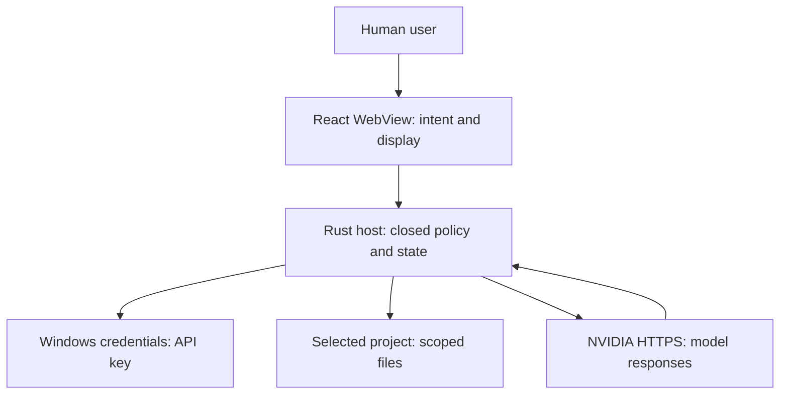

<!-- OCT9 CPU AND GLIB OWNER DECISION BEGIN -->
> Owner decision and current applicability — 2026-10-09 17:14:45 UTC: PR #30 is normally merged; its distinct actual-main package run remains FAIL after two CPU-probe failures, not a qualified main installer. The [separate CPU repair contract](../qa/CPU-CONTAINMENT-20261009.md) preserves the 10-second user-CPU and 15-second wall budgets and all mandatory gates; changed-source execution remains NOT RUN until fresh evidence. [GLib 0.18.5 remains OPEN and UNRESOLVED](../qa/GLIB-UPSTREAM-DEFERRAL-20261009.md), deferred to a complete compatible stable upstream chain; no backport, dependency remediation, dismissal or ignore is authorised. GTK4/Tauri 3 is a future owner-preferred architecture review, not an approved migration or promised fix. Earlier bodies below are retained dated source-bound history; no historical PASS transfers to changed source or owner/manual/live/signing/production acceptance.
<!-- OCT9 CPU AND GLIB OWNER DECISION END -->

<!-- OCT9 FINAL FOLLOW-UP BEGIN -->
> Operational follow-up — 2026-10-09 14:18:44 UTC: the [completed-source reconciliation](../qa/OCT9-RECONCILIATION-20261009.md#completed-p11-and-final-documentation-follow-up) records the newer tested-source facts and owner decision. For the observed status of later documentation-only CI, normal integration, actual main-push and Gmail handling, consult the [PR #30 closing receipt](https://github.com/comzulca/Aster-desktop/pull/30#issuecomment-6082465272), [live PR #30](https://github.com/comzulca/Aster-desktop/pull/30) and [Actions](https://github.com/comzulca/Aster-desktop/actions). Earlier cutoffs below remain dated history; green results never transfer to a changed source. The glib alert remains OPEN for separate work; manual/live/signing/production acceptance is not inferred.
<!-- OCT9 FINAL FOLLOW-UP END -->

<!-- OCT9 CURRENT APPLICABILITY BEGIN -->
> Current-source applicability — 9 October 2026, 13:02:58 UTC: the [dated reconciliation](../qa/OCT9-RECONCILIATION-20261009.md) owns the newer exact-source outcomes and their limits. Earlier “current”, “pending” and NOT RUN statements below remain source-bound history where superseded there; original bodies and before-code approvals are preserved. P10 hosted success does not qualify a changed cumulative source. Final-source CI/package gates require re-execution; owner flicker FAIL, all 42 compound cases NOT RUN and independent manual/live/signing/production obligations remain.
<!-- OCT9 CURRENT APPLICABILITY END -->

# THREAT-MODEL-0001 — Aster-desktop v0.1.0

<!-- P10 CURRENT APPLICABILITY BEGIN -->
> Current-source applicability — 8 October 2026, 21:51:41 UTC: the [dated reconciliation](../qa/OCT8-RECONCILIATION-20261008.md) owns this checkpoint. PR #38 and #31–#35 are normally merged after their four exact-source gates; #36/#37 remain pending. P9's complete Windows suite is FAIL; its isolated synthetic diagnostic PASS does not override it. The [P10 scoped-factory contract](../qa/PDF-SCOPED-FACTORIES-20261008.md) received before-code design approval at 21:47:59 UTC; source/documentation preparation is in progress, not a published or native/package PASS. Earlier “current” headings and statuses below are retained dated history, not the latest source result. The dependency auxiliary case is a private child lease-denial test, not Credential Manager proof. Owner v0.2.2 flicker/Code Integrity FAIL and all 42 compound cases NOT RUN remain; manual/live/signing/production acceptance is not inferred.
<!-- P10 CURRENT APPLICABILITY END -->

> Current-source applicability — 8 October 2026, P9 preparation: the [dated reconciliation](../qa/OCT8-RECONCILIATION-20261008.md) supersedes current-status claims below. PR #38 and #31–#34 are normally merged after four source-bound gates; PR #35–#37 and PR #30 are not complete. P8's native Windows access violation remains FAIL, its installer SKIPPED. The [P9 contract](../qa/PDF-CRASH-DIAGNOSTIC-20261008.md) admits only test-only diagnosis after the unchanged complete suite fails; 112 counted pure checks and static review are not native qualification or an installer PASS. The dependency auxiliary test is an isolation lease test, not native credential execution. Original dated results, owner v0.2.2 flicker/Code Integrity FAIL, credential custody and manual/live/production obligations remain unchanged.

**Retained dated v0.2.3 applicability — 4 October 2026, Edinburgh / Europe/London:** dated evidence below retains its original source, version and result; it does not qualify changed v0.2.3 bytes. Unchanged constraints remain subject to the [current documentation index](../V0.2.3-DOCUMENTATION-INDEX.md) and [SPEC-0005](../specs/SPEC-0005.md). The owner authorises a v0.2.3 PR and GitHub checks only, not merge, release or signing. Final-source, package, native and live qualification require independent evidence in [LOCAL-V023-0001](../qa/LOCAL-V023-0001.md). No retired provider, historical grant or old PASS is reactivated.

**Current-status navigation — 8 October 2026:** see [the reconciliation record](../qa/OCT8-RECONCILIATION-20261008.md) for actual PR/dependency/source/gate outcomes and the later owner-authorised conditional integration. This dated paragraph and the original evidence below are preserved history, not current authority, a new execution receipt or a reactivation of retired providers. Manual/native/live/production results do not transfer between sources.

**v0.2.2 applicability, 3 October 2026:** retained requirements/contracts apply only where unchanged; retired providers, disabled capabilities and older dated results are not current authority or new-source PASS. [SPEC-0004](../specs/SPEC-0004.md), [ADR-0017](../adr/ADR-0017.md) and [LOCAL-V022-0001](../qa/LOCAL-V022-0001.md) govern active zoom/startup changes and fresh evidence. Earlier evidence remains source-bound history; the later owner-reported v0.2.1 startup flash is recorded separately. The entire original v0.2.1 checkout/installer is unchanged.

**Historical applicability, reconciled 3 October 2026:** the dated record/procedures below retain their original version, identifiers, authority limits and PASS/FAIL observations. They do not qualify or authorise changed v0.2.1 source, current key activation, retired providers or disabled project capabilities. Active scope is [SPEC-0003](../specs/SPEC-0003.md) and fresh verification is [LOCAL-V021-0001](../qa/LOCAL-V021-0001.md); no old PASS transfers.

Historical v0.1.0 evidence/procedure only. Its stable IDs, authorisation history, hashes and PASS receipts are preserved, not transferred to v0.2.0. Current scope is [SPEC-0002](../specs/SPEC-0002.md) and [v0.2.0 verification](../qa/LOCAL-V020-0001.md). Retired providers, ephemeral history and project permissions below do not apply to the current profile.

Status: versioned threat assessment, created 2026-09-24 UTC; protocol-2 assessment retained from 2026-10-01 UTC and current evidence/scope reconciled 2026-10-02. Scope: Windows 11 app, local project, native credential custody, two NVIDIA hosted models, private source repository. Code presence is not acceptance; each mitigation is credited only at its tested boundary and source revision. Source of normative IDs: `docs/specs/SPEC-0001.md`. Decisions: `docs/adr/ADR-0001.md` through `ADR-0006.md`, `ADR-0008.md`, and `ADR-0009.md`.

## Current v0.1.0 engineering disposition — 2026-10-02

Delivered source `1782d3375db47466f89be6bd3cd3c6affbfa95b7`, main run `37040168700`/attempt 1 and artifact `11243338033` have complete automatic and independent unsigned-artifact qualification PASS (100 Rust/25 frontend tests, all four CI jobs). The owner confirms the installed build matches that deliverable and reports **PASS** for six manual categories: UI, performance, providers/history, credential/uninstall, project/files, and engineering-scope acceptance. The reported tests were on 2026-10-02 in Edinburgh, Europe/London, BST (UTC+01:00), using the existing Windows 11 administrator account with Aster **not elevated**. No exact test clock time was supplied. [OWNER-ACCEPTANCE-0001](../qa/OWNER-ACCEPTANCE-0001.md) preserves that owner report separately from observed automatic proof.

Every obligation not completed within that report is expressly deferred for v0.2.0 review in [V0.2.0-FOLLOW-UP-0001](../qa/V0.2.0-FOLLOW-UP-0001.md). In particular, installed exact-body/zero-send/continuation and deterministic proposal-injection proof, advanced native-review/secret-boundary evidence, quantitative performance details, physical power-loss and safe existing-file publication are not globally marked PASS. Source helper-process termination/restart remains distinct from installed UI and physical durability. `applyExistingFile=false` and all host security invariants remain unchanged. Existing same-user/elevated-interference risks, provider cost/timing limits, notice/legal limitations and unsigned/non-production classification are not erased by acceptance.

Issues #11/#12 can close only for the accepted v0.1.0 engineering scope with this visible transfer. Their closure is not a security-completion, feature-enablement, signing, distribution or production-promotion decision. This documentation reconciliation performs no new runtime test or live request and changes no credentials, protections, privileges or capability flags.

## Assets, actors and boundaries

| Classification | Examples | Expected handling |
| --- | --- | --- |
| Secret | NVIDIA API key | Native Windows credential store and trusted Rust process memory only. Never renderer, repo, export, trace or model input. |
| Restricted | Local project files, proposed diffs, chat messages, project-bearing prompts | Host-scoped reads; renderer receives file metadata only, while the owner-HWND native surface displays the exact disclosure/proposal. Disclose to NVIDIA through explicit per-request send. No disk chat history. |
| Untrusted | NVIDIA SSE/JSON, model text, selected project files/AGENTS.md, filenames | Parse with size/schema limits; render as inert data. Instructions inside them cannot change host permissions. |
| Internal operational | Root identity, grants, nonces, file hashes, journal, status logs, source commit/build artifacts | Host-only decision state, minimal redacted logs, versioned policy, revision-bound evidence. |

The human user controls root selection and individual approvals, but a compromised user account or malicious same-user process is outside the Credential Manager confidentiality guarantee. The renderer, all model output, local project content and remote provider are lower-trust inputs. The host is the only authority broker; Windows OS and filesystem provide primitives whose real behavior must be tested on the target.

The arrows cross different trust boundaries: user intent to renderer, untrusted renderer to privileged host, host to Windows Credential Manager, host to mutable filesystem and host to external NVIDIA. GitHub/CI introduces an independent source/release boundary; repository privacy is verified as an operational property, not assumed from its name.

## Threat register and retained 2026-10-01 evidence checkpoint

The threat descriptions, trace IDs and host mitigation obligations below remain normative. Their residual-status wording is the retained 2026-10-01 checkpoint, not the current completion summary; the current disposition and explicit v0.2.0 transfer above supersede its pending final-package/manual scheduling statements without rewriting historical proof or completing unobserved security tests.

| TM | Threat and entry point | Requirement / acceptance / negative test | Mitigation owner and intended behavior | Residual risk / gate |
| --- | --- | --- | --- | --- |
| TM-001 | Malicious WebView, renderer XSS or forged window invokes credential getter or sees key in IPC/logs. | SEC-001, SEC-002 / AC-013, AC-020 / T-015, T-022 | Rust credential service; native key input; restrict Tauri command permissions to trusted window, never return bytes. Synthetic Windows credential and forged caller tests. | Same-user malware still possible (TM-012). Exact-source local automatic fixtures pass; installed-app secret-boundary evidence is pending. |
| TM-002 | Prompt injection in model text or project `AGENTS.md` asks the host to execute shell/web/MCP or approve a file write; caller forges typed IPC or capability status. | SEC-002, SEC-013, FR-012, FR-015 / AC-014, AC-020, AC-028 / T-016, T-022, T-038 | Rust IPC policy; closed schemas, caller/window check, protocol-2 capability validation, unknown field and oversized rejection, plain-text rendering. Renderer event cannot grant itself privilege. | Exact-source local automatic evidence passes; hosted CI/package binding and manual installed-app boundary inspection remain pending. |
| TM-003 | Provider/model confusion, injected URL, redirect or proxy sends key to another origin; malformed SSE triggers retries or cross-request state. | SEC-003, FR-001, FR-002 / AC-003, AC-004, AC-021 / T-003, T-004, T-005, T-023 | NVIDIA adapter; exact origin/model allowlist, HTTPS/TLS, reject redirect/proxy, no implicit retry/fallback, bounded parser and per-pair fixtures. | Exact-source local pair/loopback fixtures pass; completed hosted CI/package binding and both live canaries remain independent. |
| TM-004 | Renderer or model passes `..`, absolute/UNC/device path, malformed separator or stale root to read or write outside selected project. | SEC-004, SEC-012, FR-005, FR-006, FR-016 / AC-007, AC-008, AC-022, AC-029 / T-008, T-009, T-010, T-024, T-039 | Windows file service; native root/file selection, identity-bound grants, component walk, typed relative paths, metadata-only IPC and final host revalidation. | Exact-source local integration passes; hosted CI/package binding and installed Windows 11 review remain pending. |
| TM-005 | Symlink, junction, reparse path, hardlink, ADS, protected `.git`/secret file or binary aliases an unintended resource. | SEC-004, SEC-006 / AC-008, AC-022 / T-010, T-024 | Windows file service; deny any reparse component, hardlink count >1, ADS/UNC/device paths, deny sensitive names, limit UTF-8 and size; revalidate identity at use. | Exact-source local native fixtures pass; installed target review is pending. Hardlink aliases/backup privileges outside the threat model remain residual. |
| TM-006 | Model calls an unlisted tool, auto-approves a proposal, swaps diff after review or replays/duplicates a confirmation. | SEC-005, SEC-013, FR-007, FR-008, FR-017 / AC-009, AC-010, AC-023, AC-030 / T-011, T-012, T-025, T-040 | Grant state machine; typed proposal, exact owner-HWND native review, separate human action, nonce, request/conversation/root/path/old+new SHA-256, expiry and one use, host revalidation. Existing replacement never publishes. | Human can approve a malicious but faithfully displayed new file; no automated semantic safety claim. Exact-source local automatic integration passes; manual evidence remains pending. |
| TM-007 | Concurrent writer changes a file after comparison, `ReplaceFileW` targets wrong generation, crash leaves partial/ambiguous state or journal is lost. | SEC-006, FR-008, FR-009, FR-017 / AC-010, AC-011, AC-024, AC-030 / T-012, T-013, T-026, T-040 | Windows file service; identity/hash recheck, private durable metadata journal, `CREATE_NEW` for new files, same-handle verification and conservative recovery. `ReplaceFileW` by path is not expected-hash CAS. | Existing-file apply is **disabled/proposal-only**. Exact-source local new-file independent-process termination/restart fixtures pass; hosted CI/package binding and physical power-loss evidence remain pending. |
| TM-008 | Duplicate/out-of-order SSE or cancellation causes multiple terminal results, cross-conversation content or post-cancel tool execution. | NFR-001, FR-003 / AC-005, AC-017 / T-006, T-019 | Host state machine; unique request IDs, fixed transitions, exactly one terminal event, cancellation token, per-request parser isolation; compare repeated fixtures. | Live provider timings remain nondeterministic. |
| TM-009 | Oversized file, infinite stream, slow network, huge diff, excessive events or repeated calls consume resources/cost. | NFR-002, NFR-004 / AC-018, AC-031 / T-020, T-041 | Host budgets; one application-wide active provider request, 64 KiB input, 512 KiB context/answer, 1 MiB text read, 256 KiB changed content, 8 MiB wire response, 256 KiB frame, 262,144 events, 10s connect/30s headers/60s idle/900s total, zero automatic retries/tool loop. | Provider billing can still accrue within one authorized request; no hard provider spending cap or provider-latency guarantee claimed. |
| TM-010 | Project contents leak through renderer IPC, implicit prompt assembly, continuation history, stale snapshot/proposal memory, debug logs, desktop persistence, export, crash dumps or source control. | SEC-007, SEC-008, SEC-012 / AC-012, AC-025, AC-029 / T-014, T-027, T-039 | Host/UI and release engineer; metadata-only IPC, exact per-request native disclosure, 32-KiB ephemeral project turn, failed/cancelled snapshot revocation, five-minute rights plus 60-second expiry heartbeat, redacted logs, deny secret files and no chat database. | Completed egress intentionally retains only the bounded proposal right until expiry. OS crash dumps and same-user memory inspection require separate OS hardening; no zero leakage promise. Installed-app inspection is pending. |
| TM-011 | Public repo, inherited org roles, stale green CI, unsigned older artifact, incomplete notice provenance or secret in commit creates a false release/privacy claim. | PR-002, SEC-009 / AC-002, AC-019 / T-002, T-021 | Repo owner and release engineer; inspect roles/visibility, secret and license scans, pinned revision, schema-2 target-required notice closure, extracted NSIS resource hashes, artifact hash/signature evidence and explicit promotion decision. | Repository privacy and scoped connector access were verified at publication; roles/rules require promotion review. Structural notice/payload evidence is neither an exact binary SBOM nor legal approval. |
| TM-012 | Another process running as the same Windows user calls `CredReadW` for a generic credential. | SEC-001 / AC-013 / T-015 | OS/host boundary; minimize key lifetime in process and never expose via renderer; Windows Defender/ESET account compromise controls remain operational. | Inherent residual risk of Windows Generic Credential user scope; user-owner risk acknowledgment pending, cannot claim exclusive app access. |
| TM-013 | Diagnostic arguments, target confusion, malformed/pre-existing credentials or unconditional cleanup cause a synthetic GUI test to access/change/delete production or unrelated credentials. | FR-013, SEC-010 / AC-026 / T-033, T-034 | Host diagnostic; early closed dispatch, opaque internally generated namespace, typed target revalidation at every OS operation, raw presence fail-closed checks, known synthetic password only, zeroizing buffers and no blind cleanup. The diagnostic starts before and grants none of the nine shipping IPC commands. | Same-user malicious racing processes are outside the Generic Credential compare-and-delete guarantee; no atomic custody CAS is claimed. Wrong/foreign/ambiguous state remains untouched and needs owner attention. Automated fixture PASS is not actual GUI acceptance or production Tauri handler proof. |
| TM-014 | Inherited/broad/NULL journal ACL, wrong owner, path-versus-handle replacement or directory/record permission drift exposes recovery metadata or admits a foreign record before publication/recovery. | FR-014, FR-017, SEC-011, SEC-006 / AC-027, AC-030 / T-035, T-040; privacy subsection of T-031 | Native storage owner; create only new exact host-selected objects with protected current-user descriptors; retain ancestor/directory handles and identity; validate bounded owner/closed ACL by handle before enumeration/read/write/decryption and before success; reject existing weak objects unchanged. | Same-user malicious code, elevated administrators/SYSTEM and physical power-loss are separate residuals, not excluded by owner-only DACL. No global policy, privilege, parent-folder or credential ACL modification. Exact-source local T-040 portions pass; hosted CI/package evidence is pending. |
| TM-015 | A forged file receipt, renderer-supplied path/content/approval, wrong owner window, post-review file drift, or body reserialization leaks different project bytes or enables an unreviewed mutation. | FR-015–FR-017, SEC-012, SEC-013 / AC-028–AC-030 / T-038–T-040 | Protocol-2 host boundary; native file picker and retained snapshot, metadata-only receipt, authenticated main-HWND native review, non-serializable one-use approval, exact serialized-body dispatch, post-review identity/hash revalidation, ephemeral continuation, private journal and `CREATE_NEW`. Existing replacement stays proposal-only. | Exact-source local hostile-input/exact-body/process-restart fixtures pass. Completed hosted CI/package binding is required before engineering handoff. Feasible installed review on the current primary laptop/principal account follows handoff and blocks installed-feature acceptance or production promotion. Same-user/elevated interference remains residual. |

## Historical engineering-handoff and acceptance blockers — 2026-10-01 UTC

These dated pre-handoff statements are preserved as historical evidence. The exact final engineering package has since passed qualification, the owner-reported six manual categories have passed, and remaining obligations are transferred as described in the current disposition above. Normative capability activation gates, residual risks and proof distinctions still apply.

The protocol-2 capability change invalidates the prior `b0610c5` installer as a deliverable for the changed behavior. Applicable local automatic T-038–T-040 portions now pass at immutable runtime source `2bcacd7c6f2496eda233d4a069ec7b65a93d47b3`; the later packaging/evidence source, complete main-branch CI, inventories, extracted payload/notices evidence and unsigned packaging remain required before engineering handoff. The following remain independent post-handoff acceptance or promotion gates: installed Windows 11 GUI/accessibility/performance acceptance, owner credential GUI/secret-boundary inspection, two authorized live canaries, and any existing-file replacement design.

ADR-0008 / T-037 adds a read-only source-policy check to TM-011: compare exact locked root API and unique Rust tauri major/minor before dependent jobs, rejecting unknown/ambiguous inputs. Historical dependency alignment passed at `b0610c5`, but it does not substitute for the changed candidate's frozen/locked installs, supply-chain audit, actual bundling, payload notices or source-bound target acceptance. No version-mismatch bypass is authorized.

1. Historical synthetic Windows Credential Manager fixtures do not pass the installed production dialog/renderer secret boundary. Owner GUI interoperability and changed-source evidence remain **NOT RUN**; do not declare live Windows connectivity from a configured Boolean.
2. Historical per-provider fake SSE fixtures do not pass the changed source or either live model. Re-run exact-pair fixtures, then record exactly the two separately authorized live canaries on the final installed artifact; do not retry or fall back.
3. Existing-file **apply** is disabled because no accepted conflict-safe publication primitive and native race/crash/recovery suite exists. New-file `CREATE_NEW` is independently implemented and its local process-termination/restart fixtures pass; completed hosted CI/package binding is required before engineering handoff. Feasible installed-target observations follow handoff and block installed new-file acceptance or production promotion, while absent diagnostic-seam rows remain disclosed NOT RUN.
4. The private repository, one organization member visible at inspection, and repository-scoped connector authorization were verified at publication. Other inherited organization/enterprise privileges, collaborators and branch rules have not been exhaustively verified for a sole-owner release claim.
5. The verified `b0610c5` unsigned installer is historical after the protocol-2 runtime change. A new exact-source unsigned artifact, payload/notices evidence and hash are required. Windows 11 installation/launch/uninstall and performance are owner-run; signing is intentionally outside the engineering classification and no production claim is permitted.

## Review instructions

### 2026-09-30 engineering candidate delta

ADR-0004 maps T-028 to TM-001/TM-012 (bounded manual Credential Manager representation; no enumeration/secret IPC), T-029/T-030 to TM-002/TM-006/TM-009 (strict typed data and full inert host-native review), T-031 to TM-005/TM-007/TM-010 (no-clobber identity/journal/recovery and encrypted restricted metadata), and T-032 to TM-004/TM-006/TM-010 (revocation, replay, stale root and disclosure). No new runtime authority is inferred from these candidate internals. Native Windows 11 review, journal ACL/privacy, competing writers and crash points still require target evidence before any independent capability flag changes. The owner selected unsigned engineering-only artifacts; signing is not required for that classification and is not claimed.

For every new provider, grant, tool, storage format or IPC command, add a threat and an adversarial test before enabling the capability. An observed FAIL remains visible; a follow-up PASS must identify the new revision and run. Human approval is authorization for the requested operation, not proof the model's proposed code is safe or correct.
